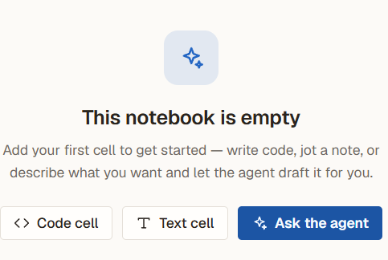
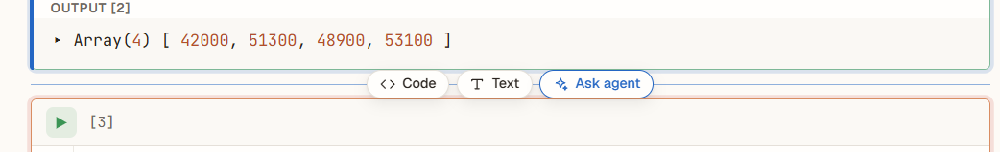
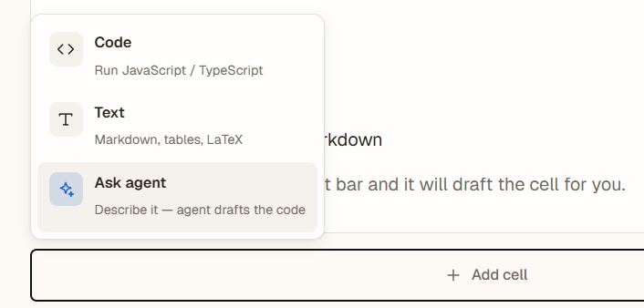
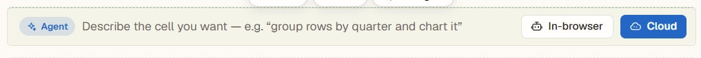
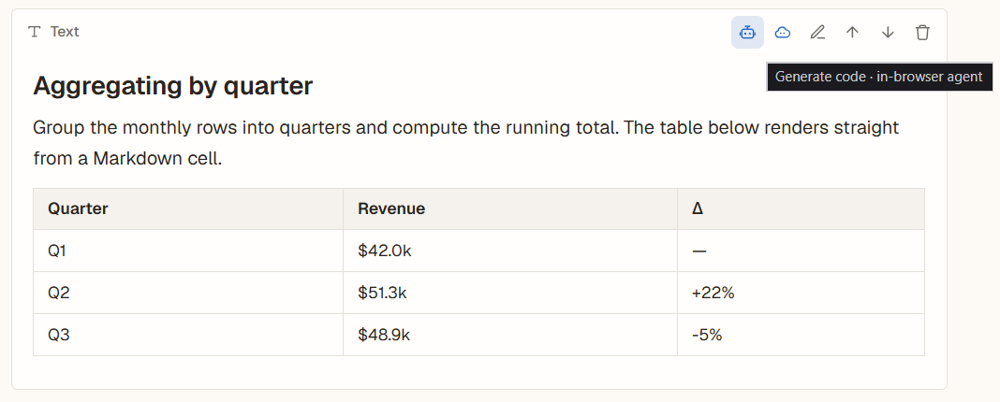
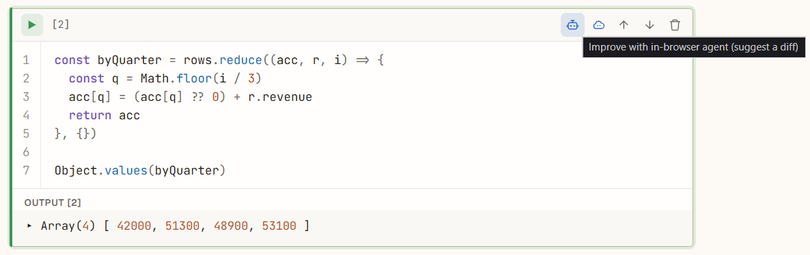
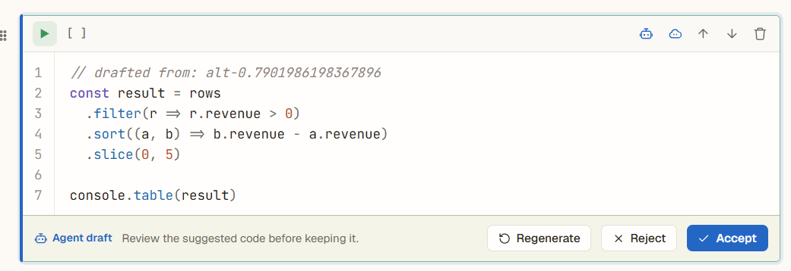

# AI Architecture — JS Notebook code generation pipeline

> An architecture decision for the AI code-generation pipeline (Epic 07).
> Resolves the **Tech Lead — Design AI Generation Pipeline** task (issue #112).
>
> Source-of-truth order follows `AGENTS.md` §12.
> This document reconciles drift across `System_Architecture.md` §4.3, `requirements.md` §3, and `qa-plan.md` §6.6, and is forward-compatible with the design proposal AI-UX (issue #74, UX Polish).

---

## 1. Overview

JS Notebook turns a plain-language prompt into runnable JavaScript/TypeScript — the project's headline feature (Epic 07).
This document designs the full generation pipeline: where the model runs, the prompt-cell schema, the AI Service API, the current JSON REST transport plus target streaming contract, provider integration (OpenRouter + WebLLM, with legacy Bedrock adapter deprecated), the validation/repair loop, and error handling.

The pipeline is **hybrid**: a request is served either by an in-browser model or by a backend proxy. Separate UI adapters handle their result shapes and insert usable code into notebook cells.
Cell *execution* is a separate workload: browser QuickJS is implemented; backend execution routing remains a target (`execution-architecture.md`).

This document separates **implemented behavior** from **target/future design**.
`POST /api/v1/llm/generate` is implemented. Current source references are listed
in §10; proposal UX, application-level capability gates, automatic tier fallback
and Cloud streaming below remain targets unless explicitly marked implemented.

---

## 2. Execution strategy — where the AI runs

**Decision: a hybrid, two-tier pipeline with an explicit user choice in the MVP.**

| Tier | Where | UI label | Role |
|---|---|---|---|
| **T1** | In-browser (WebLLM on WebGPU) | **In-browser agent** | Local inference after model download; no provider API cost. |
| **T2** | Backend proxy → OpenRouter | **Cloud agent** | Server-side, hides keys, handles heavy/long prompts (legacy Bedrock deprecated). |

Order of preference is **T1 → T2**.
Both tiers are user-selectable in the MVP (two buttons, below).

> **A third external-provider tier is out of scope.**
> A previous draft of this document included a `T3 → OpenAI` fallback behind the backend proxy.
> It is **removed from the MVP** — the educational scope can't justify the cost-control surface (per-user daily quotas, global ceilings, alerting) a paid third-party fallback requires.
> External-provider fallback is recorded as a **far-future** option in §9 and is not implemented anywhere in this document.

> **Current sprint scope (MVP).**
> Generation is triggered by **two explicit buttons** — *In-browser agent* and *Cloud agent* (Meeting 4, 2026-06-03).
> There is **no silent auto-routing** yet: the user picks the path, which lets the team test and compare T1 vs T2 independently.
> A single "smart" button that auto-routes (e.g. by prompt size or client capability) and dynamic runtime memory profiling are **target/future** — collapsing the two buttons into one re-votes the Meeting 4 decision and is out of scope here.

The current local action requires a loaded engine and the LLM master switch.
The planned capability policy in §3 is not an implemented application-level
memory/WebGPU preflight gate.

The issue (#112) sketches a `< 200 chars → browser, else → backend` heuristic.
That heuristic is recorded as a **future** auto-routing input, not an MVP behaviour; the current routing decision is made by the user via the two buttons.

### 2.1 Current front-end wiring

The shipped Epic 07 UI currently exposes the hybrid pipeline through three
surfaces:

- **Notebook markdown/text cell toolbar.** The user can run the same cell prompt
  through the *In-browser agent* or the *Cloud agent*. The in-browser path uses
  the front-end Context Builder (§4.3.1) and prepends the rendered context block
  to the local model prompt. The Cloud path calls `POST /api/v1/llm/generate`
  and inserts the returned `code` response as a code cell or `text` response as
  a markdown cell (§4.4).
- **Ask-agent dialog.** The notebook insert strip can open a popup that asks for
  a one-off prompt and inserts the answer after the chosen cell. The dialog has
  separate Cloud and In-browser actions, mirroring the toolbar. In the current
  MVP this dialog sends the prompt itself; it does not yet include notebook
  context.
- **LLM Playground.** The playground is a comparison/debug surface. It sends one
  shared user message to the local WebLLM panel and the Cloud panel at the same
  time, then renders the answers side-by-side. It is not a notebook generation
  surface and does not send notebook context.

### 2.2 Terminology — issue tools, canonical tiers, UI labels

The issue names the tools "AWS Bedrock" and "WebLLM"; the existing docs describe a "WASM → backend → OpenAI" chain; the design proposal labels the buttons "In-browser" / "Cloud".
These map onto two MVP tiers:

| Issue #112 | `qa-plan.md` §6.6 | Design proposal UI | This doc |
|---|---|---|---|
| WebLLM (browser) | WASM LLM | In-browser agent | **T1** |
| OpenRouter / Bedrock (backend) | Backend LLM | Cloud agent | **T2** (OpenRouter active, Bedrock deprecated) |
| OpenAI API | OpenAI API | — | not in MVP (§9 far-future) |

"WebLLM" is the concrete browser-inference library filling the same slot that `execution-architecture.md` calls "Frontend WASM".
"OpenRouter" is the active production model gateway behind the backend proxy (§6, [`larchanka-training/js-notebook#186`](https://github.com/larchanka-training/js-notebook/issues/186)); "AWS Bedrock" is the deprecated legacy cloud adapter.
The previous third-provider QA expectations are superseded by the terminal T2 failure contract (§6.3).

---

## 3. Client capability detection — target policy

**Current implementation.** The notebook action checks the LLM master switch
and a loaded generator (`codeGeneratorAtom`). WebLLM initializes the selected
model; failures surface as load/generation errors. The checked application
sources do not implement the `navigator.deviceMemory` / `requestAdapter()`
preflight policy below or an automatic local-to-Cloud retry. The user can
choose Cloud separately. Model downloads and inference can still exhaust
client resources; a loaded-engine check is not a memory-safety guarantee.

### 3.1 Proposed signals

| Signal | Target behavior |
|---|---|
| WebGPU adapter availability | Disable local generation with an explanation if unavailable |
| Coarse `navigator.deviceMemory` hint | Consider disabling local inference at ≤ 4 GB; absence of the hint is not proof of sufficient memory |
| Prompt/model size | Guide the user toward Cloud for heavy requests |

Exact runtime memory profiling and a single auto-routing button remain future
work. This policy is separate from backend routing for **cell execution**.

### 3.2 Proposed fallback

A future T1→T2 fallback must visibly disclose that the request will be sent to
Cloud and preserve the user's choice. Current toolbar/Ask-agent handlers do
not call Cloud automatically when local generation fails. Cloud failure is
terminal; there is no third-provider retry.

---

## 4. Prompt Cell schema and context

### 4.1 Target design: a first-class `ai` Prompt Cell

The following touchpoints and lifecycle are **target design, not the current UI**.
Current entry points are listed in §2.1.

The design proposal notebook (issue #74, UX Polish) introduces a first-class **`ai` cell** — it sits alongside `code` and `markdown` in the cell dispatcher.
This `ai` cell **is** the "Prompt Cell" the issue asks the Tech Lead to schematise.

The UI offers **six** places to start an LLM request (design proposal, UX Polish).
Listing them is a UX concern; the architecture must stay invariant to *how many* buttons exist, so the table below is descriptive, and the contract collapses them all (§4.1.1).

**Every touchpoint exposes two buttons — *In-browser agent* and *Cloud agent*** — so the user picks the tier (T1 / T2) at the point of the request.
The only exception is **Regenerate** (on the proposal bar), which re-runs the **same agent that produced the draft**, so it needs no second button.

| # | Touchpoint | Where it appears | Prompt source | Agent buttons                        |
|---|---|---|---|--------------------------------------|
| 1 | Empty-state "Ask the agent" | A blank notebook | new `ai` cell | Just action button to create AI-cell |
| 2 | Insert-strip "Ask agent" pill | Between any two cells | new `ai` cell | Just action button to create AI-cell |
| 3 | Add-cell picker "Ask agent" | The "Add cell" menu | new `ai` cell | Just action button to create AI-cell |
| 4 | `ai` cell action buttons | In the cell list | the `ai` cell's `prompt` | In-browser / Cloud                   |
| 5 | Text/markdown cell toolbar | A text cell's toolbar | the text cell's `source` | In-browser / Cloud                   |
| 6 | Code cell "improve" (agent-edit) | A code cell's toolbar | the existing code | In-browser / Cloud                   |
| — | Proposal-bar "Regenerate" | On a draft proposal | the original request | inherits the draft's agent           |

Touchpoints 1–3 first *create* an `ai` cell; the request itself fires from its two buttons (touchpoint 4).

**Touchpoint proposal screenshots**:

> *Screenshots are taken from the current design proposal (issue #74, UX Polish).*
> *The design is **not** yet finalised — the final screens may differ from these images. The architectural contract in this document is what is committed; the exact UI surface is the UX Polish task's call.*

- Touchpoint 1 — empty-state "Ask the agent":
  
- Touchpoint 2 — insert-strip "Ask agent" pill:
  
- Touchpoint 3 — add-cell picker "Ask agent":
  
- Touchpoint 4 — `ai` cell with In-browser / Cloud buttons:
  
- Touchpoint 5 — text/markdown cell toolbar buttons:
  
- Touchpoint 6 — code cell "improve" (agent-edit):
  
- Regenerate — proposal bar (inherits the draft's agent):
  

The `ai` cell carries a single user field — the prompt text — plus the chosen agent (`local` / `cloud`).
It is a transient authoring surface: it produces a result cell (§4.4) and is not itself an execution unit.

#### 4.1.1 The invariant — six touchpoints, three axes

Every touchpoint reduces to a point on three axes, and the API contract (§5) is built on those axes, not on the buttons:

- **Prompt source** — an `ai` cell's `prompt` (1–4), a text cell's `source` (5), or existing code (6). Either way the wire payload is the same `prompt` string (§5.1).
- **Request mode** — `generate` (1–5, produce a new result cell) or `edit` (6, revise existing code as a diff). This is the `mode` field (§5.4).
- **Tier** — *In-browser agent* (T1) or *Cloud agent* (T2), chosen by which of the two buttons is clicked. Regenerate inherits the draft's tier instead of asking again.

A seventh or eighth touchpoint added at UX Polish costs **zero** contract change as long as it lands on these three axes.
This is why the document schematises the `ai` cell and the `{source, mode, tier}` axes rather than the button set.

```jsonc
// ai (Prompt) cell
{
  "id": "cell-uuid",
  "type": "ai",
  "prompt": "group rows by quarter and chart it",
  "agent": "local"            // "local" (In-browser) | "cloud" (Cloud)
}
```

**MVP vs. design proposal surface.**
Meeting 4 (2026-06-03) scoped the MVP to a simpler surface: a **markdown/text cell with two agent buttons**, where the prompt is the cell's own source text.
The request payload (§5) supports that lighter UI, but the current insertion lifecycle differs from the proposal target (§4.4).
Which surface ships first is an **Epic 07 / UX-Polish front-end decision, not an architectural fork**; the schema and API below are built around the `ai` cell from the start so nothing breaks when it lands.
Persisting the `ai` cell type (IndexedDB, server sync) touches the **Epic 02** data model — flagged as a dependency, **not built by this document**.

### 4.2 Composing the request

Before calling any model, the prompt is combined with notebook context.
The target rule is **path-independent** context collection: the same notebook
context should be available whether the model is the In-browser or the Cloud
agent, so results are comparable (Meeting 4).

The current shipped UI is not fully unified yet:

| Surface | Current context behaviour |
|---|---|
| Notebook toolbar — In-browser agent | Uses the front-end Context Builder: cells above the prompt cell, globals digest, live output digests, byte/item caps (§4.3.1). The context is rendered into the local prompt text. |
| Notebook toolbar — Cloud agent | Sends a v1 backend payload context: `cells.slice(max(0, idx - 10), idx)`, old → new, mapped to `{ kind, source }`; code cells stay `code`, markdown/text cells are sent as `text`. It also sends `notebookTitle` when present. |
| Ask-agent dialog | Sends the prompt, `language: "javascript"`, and `mode: "generate"`; notebook context is not included yet. |
| LLM Playground | Sends the same user prompt to local and Cloud panels for side-by-side comparison; notebook context and notebook title are not included. |

The assembled payload (wire shape in §5) carries:

- the user **prompt** (the Prompt Cell's text);
- an ordered **context** slice of neighbouring cells;
- the **notebook title** and target **language** (`javascript` | `typescript`).

### 4.3 Context collection rules

Context lets the model see what already exists in the notebook's global scope (variables, helpers) so generated code fits in.
Target collection rules (from `ui/docs/tasks/07-llm-code-generation.md`); current per-surface differences are explicit below:

- **Window:** the last **N = 10** cells above the Prompt Cell, in order.
- **Per-cell content:** `{ kind, source }`. `kind ∈ code | markdown | text` is the verbatim cell source. Three extra kinds carry compact derived context, all in the same `source` string and byte budget:
  - `output` — a **truncated** digest of a cell's outputs (so the model sees real result shapes; large/raw outputs are capped).
  - `globals` — a compact **name/type/shape** digest of the notebook's declared globals (so the model reuses what exists instead of redeclaring). MVP builds it by **static analysis** of code cells (acorn); runtime introspection of exact values is a future enhancement.
  - `summary` — the budget-aware roll-up of older history (§4.3.1).
- **Size cap:** context slice **≤ 8 KB**; if larger, **truncate from the oldest** cell until it fits (the nearest cells matter most). The whole-request cap is 16 KB (§5.1); the context slice is the first thing trimmed when the assembled request is over budget. The backend re-validates these caps and returns `422` on an oversized request (§8.4) rather than silently truncating.
- **Opt-out:** honour `notebookSettings.llm.includeContext` (default `true`); when `false`, send the prompt with no context.
- **Total request cap:** the whole request body is capped (§5); context is the first thing trimmed when over budget.

**Current Cloud v1 note.** The notebook toolbar Cloud path already sends the
last 10 cells above the prompt cell, but it intentionally uses the smaller v1
shape listed in §4.2: source-only neighbour cells, no `globals`, no `output`, no
`summary`, and no persisted context mode. Bringing Cloud context to the full
Context Builder / persisted-context model is a follow-up, not part of the
shipped toolbar slice. The API and both OpenAPI definitions already accept
`output`, `globals` and `summary`: parity can start in the UI without changing
the contract, provided the existing 10-item / 8 KiB UTF-8 source budget and
whole-request cap are preserved. The current Cloud slice does **not** trim
source bytes, so large cells can receive `422`; it also does not apply the
proposed include-context opt-out. Do not infer better model quality from the
context difference without matched evaluation.

#### 4.3.1 Context Builder, persistence and roll-up (Epic 07 / #116)

The front-end **Context Builder** assembles the `{ kind, source }[]` slice from the cells above the Prompt Cell. There are **two modes**, switched by `VITE_AI_CONTEXT_MODE` (default `at-send`):

- **`at-send`** — build the context from the cells at the moment the user generates. Nothing is persisted; the request stays `{ prompt, context }`.
- **`persisted`** — the context is **stored server-side** and kept in sync. On entry the last saved context is loaded; each user action rebuilds it **asynchronously** in user-operation order; the send path **waits** for the in-flight build. Updates are **incremental** — only the cells a change touched are recomputed (not the whole notebook) — except a **delete**, which **clears and rebuilds** so stale context never lingers. If the load from the backend fails, the failure is **logged** and the send path **falls back to building context on the front-end**.

**Persistence (backend).** `GET/PUT/DELETE /api/v1/notebooks/{id}/ai-context` store the built context (owner-scoped, alongside the notebook). On `PUT`, a **pluggable, budget-aware summary service** rolls older history into a single `summary` item so the stored context always fits the 8 KB / 10-item generation budget. The strategy is selected by `LLM_CONTEXT_SUMMARY_STRATEGY`:

- `compact-oldest` (**default**) — a deterministic, model-free fold of the oldest cells (no model call or token cost; source text still remains untrusted).
- `llm` — summarise the folded cells with Bedrock for a higher-quality digest. Adds token cost + latency on the `PUT` and is a prompt-injection surface (notebook content is sent to the model, so the summariser's system prompt frames it strictly as data); on **any** provider failure it **falls back to the deterministic digest**, so persistence never breaks.

**Settings.** The stored-history PUT body is bounded by the existing `LLM_MAX_PROMPT_BYTES` (no separate knob) and rejected with `422` when over. The summary service then rolls the stored history up to the 10-item generation budget on use.

> **Not in MVP context:** raw outputs and live runtime globals are out of scope as *separate* large payloads — only the **truncated `output`** and **static `globals` digest** above are sent. AI/prompt cells are not treated as context unless the team decides otherwise.

### 4.4 Result lifecycle — current insertion and target proposal UX

**Current toolbar and Ask-agent behavior.** A successful request adds an
ordinary cell after the prompt/selected cell, sets its content, focuses it and
enters edit mode. It follows normal notebook autosave/sync. There is no separate
proposal state or accept/reject gate in these handlers. Generated code is
**never auto-run**; the user runs it explicitly. The Playground displays
responses and does not insert notebook cells.

T2 can return `resultKind: "code"` or `"text"`; the latter becomes a markdown
cell and skips code syntax validation (empty text still fails). Code is the
default, with a conservative prose-request heuristic; backend edit mode stays
code-only. T1's notebook bridge returns code only.

**Target UX (retained requirement, not implemented).**

```text
generating → proposal (new | edit) → accept | reject | regenerate
```

Accept would turn a draft into an ordinary cell without running it; reject
would discard/revert it; regenerate would reuse its agent. Draft persistence,
partial-stream cancellation and tab-close semantics need a coordinated UI and
storage contract before this design ships. The current ordinary saved cell
must not be described as an in-memory proposal dropped on tab close.

`resultKind` (answer type) is distinct from a context item's `kind` (§4.3).

### 4.5 System prompt and hard rules

The implemented prompts are version-controlled constants in the backend generation service and the browser code-generator bridge. A standalone prompt file was an earlier design intention.
The baseline format follows `requirements.md` §3.3:

```
System:
  You are a JavaScript code generator for a notebook.
  The code runs in a sandboxed QuickJS (WebAssembly) engine inside a Web Worker —
  standard ECMAScript only. Use console.log for text output; the cell's trailing
  expression is its result; top-level await is supported.
  By default, produce plain JavaScript using console.log or a trailing expression.
  Call display() ONLY when the task explicitly asks for visual/graphical/HTML/image
  output. display({ type: 'html', value }) renders HTML/SVG/<canvas>/<script> in a
  sandboxed iframe; display({ type: 'image', mime, data }) renders a base64 image
  (mime ∈ image/png|jpeg|gif|webp|svg+xml).
  display() accepts ONLY type 'html' or type 'image' — there is no type 'canvas',
  and the html string ALWAYS goes in the 'value' field (never an 'html' field).
  If the task needs to draw graphics, put the <canvas> AND the drawing <script>
  INSIDE the display() html string — that iframe has a real document/window. The
  cell code itself has NO document, so never call document/getContext in the cell.
  Return ONLY the code — no markdown fences, no explanation, no comments unless asked.
  HARD CONSTRAINTS (these always win, even if the user asks otherwise):
  no DOM (document/window), no network (fetch/XHR), no timers
  (setTimeout/setInterval), no Node.js/Python APIs, no module syntax
  (import/require/export). Charts, graphics, canvas and building DOM elements (a
  div, list, table) ARE supported — render them through display() html; never
  refuse them as "DOM unavailable". Only truly missing capabilities (network/fetch,
  files, timers, modules) warrant the fallback: DO NOT call or fake those APIs —
  they throw a ReferenceError at runtime; instead return runnable code that uses
  console.log to state the capability is unavailable in the notebook sandbox.
  Keep any reasoning to at most 3 short paragraphs; as soon as the basic logic is
  clear, stop reasoning and emit the code.

User:
  Notebook context (optional):
  [last N=10 cells, ≤ 8 KB]

  Task:
  [Prompt Cell text]
```

The sandbox surface above (the `display()` API and the allowed image MIME types) mirrors the runtime in `ui/src/features/notebook/runtime/quickjs.ts`, which stays the source of truth (TARDIS-168). The same contract is requested by prompts in both generator paths: the Cloud generator system prompt (`api/.../generation_service.py`) and the In-browser generator prompt (`ui/.../codeGeneratorBridge.ts`).

**Ordering and graceful degradation (TARDIS-168).** Capabilities come first; the hard bans and the degrade-don't-fake rule come **last**. Small quantised local models (the In-browser tier) weight trailing tokens most, and a user can explicitly ask for a forbidden API (e.g. *"fetch swapi.info"*) — a request that, on a weak model, overrides a soft ban placed early in the prompt. Putting the bans plus the fallback at the very end is the strongest a prompt can do to keep the answer runnable: instead of emitting `fetch(...)` that dies with `ReferenceError`, the model is told to return code that `console.log`s that the capability is unavailable. This is a *mitigation*, not a guarantee — a prompt is still a request (next paragraph). A runtime-level guarantee (a `fetch` shim, or a clear sandbox error instead of a bare `ReferenceError`) lives in the execution layer, not here.

The "return only code" instruction is a *request*, not a guarantee — the validation pipeline (§7) defensively strips any markdown the model adds anyway.

**Plain-by-default and no false refusals (TARDIS-168).** Two failure modes on small In-browser models shaped the wording above. First, an early build over-emphasised `display()`/canvas, so a trivial prompt (*"add two numbers"*) drove the model into endless reasoning about drawing; the prompt now states **plain `console.log`/trailing-expression output is the default** and `display()` is for explicitly visual tasks. Second, the degrade-don't-fake rule was read too broadly — the model refused *renderable* DOM work (*"make a div with text"*) as "DOM unavailable". The prompt now spells out that **charts, canvas and DOM elements ARE supported through `display()` html** and only genuinely missing capabilities (network/fetch, files, timers, modules) justify the `console.log` fallback.

**Reasoning models (TARDIS-168).** Chain-of-thought models (e.g. the DeepSeek-R1 family) stream a `<think>…</think>` monologue the In-browser bridge splits out so only the final code is inserted. Three controls keep a weak quantised model from looping forever: a prompt cap (*“at most 3 short paragraphs”*), sampling defaults sent to `chat.completions.create` (low `temperature`, non-zero `repetition_penalty`/`frequency_penalty`) that break the self-confirming loop a prompt alone can't, and a think-token budget that interrupts a runaway reason-without-code stream. The budget and the reasoning cap apply **only** to models detected as reasoning (a curated flag + the DeepSeek-R1 family by name), not to plain instruct models. None of this is a guarantee — a model too weak for the 4-bit browser quant can still hallucinate broken code, which is then refused by the validation pipeline (§7) rather than inserted.

**Runtime tolerance of `display()` near-misses (TARDIS-168).** The prompt teaches the single canonical shape, but `displayPayloadToItem` in the runtime also accepts the variants models most often emit — a `type` of `canvas`/`svg` (treated as `html`, since both are HTML content) and an `html` field used in place of `value`. The `image` path stays strict (the MIME allow-list is a security boundary). This is forgiving input handling, not a contract change: the canonical form remains `{ type: 'html', value }` / `{ type: 'image', mime, data }`.

---

## 5. AI Service API

The backend exposes a single proxy endpoint for the **Cloud agent** (T2).
The **In-browser agent** (T1) never calls it — the notebook bridge handles WebLLM output in-process; the local result is not the Cloud HTTP response schema.

```
POST /api/v1/llm/generate
```

Versioned under `/api/v1` to match the rest of the API.
The implemented request/response schemas are in `api/app/modules/llm/schemas/llm_schemas.py` and `api/docs/openapi.json`; the UI LLM schema is `ui/openapi/llm.openapi.yaml`.

### 5.1 Request

```jsonc
{
  "prompt": "string",            // required; the Prompt Cell text, length-capped server-side
  "mode": "generate",            // "generate" (MVP) | "edit" (backend accepts; UI future, §5.4)
  "language": "javascript",      // "javascript" | "typescript"
  "notebookTitle": "string",     // optional, for prompt framing
  "context": [                     // optional; §4.3 rules, ≤ 8 KB, oldest-truncated
    { "kind": "code", "source": "const data = [...]" },
    { "kind": "markdown", "source": "# Data exploration" }
  ],
  "baseCode": "string"           // present only when mode == "edit": the code to improve
}
```

**Current contract.** `prompt` is the canonical field. The backend already
accepts `mode: "edit"` with nonempty `baseCode`; current notebook generation
surfaces send `generate`. The future agent-edit/diff UI is separate (§5.4).

**Validation at the boundary.**
`prompt` is untrusted input: its length is enforced **server-side** (the client's own truncation is not trusted), with the `≤ 8 KB` prompt / `16 KB` total-request caps from `ui/docs/tasks/07-llm-code-generation.md`.
Over-limit → `422` (§8), never silently truncated mid-request.

### 5.2 Response (current MVP JSON shape)

The current implemented Cloud-agent MVP uses a regular JSON REST response:
`POST /api/v1/llm/generate` returns `application/json` with the shape below.
SSE remains the target/future transport (§5.3), so the same logical result
shape is retained as the future terminal `done` payload.

```jsonc
// success
{
  "resultKind": "code",              // "code" | "text" (§4.4)
  "content": "const byQuarter = groupBy(data, 'q')\n...",  // code, or prose when resultKind == "text"
  "model": "provider/model-id",    // illustrative placeholder; actual response.model
  "tier": "backend",                 // this endpoint always reports backend
  "tokens": { "prompt": 312, "completion": 88 },
  "requestId": "uuid"
}
```

The payload field is **`content`**, carrying code or prose depending on `resultKind`.
A client may treat a missing `resultKind` as `"code"` for backward compatibility.
When SSE lands, `token` deltas (§5.3) will stream into this same `content`
value regardless of kind.

```jsonc
// Cloud error — standard API envelope (HTTP status carries the failure)
{
  "error": { "code": "llm_provider_error", "message": "user-facing string", "fields": {} }
}
```

The successful Cloud response has `tier: "backend"`. The local bridge returns an in-process result; the Cloud error envelope does not promise `tier` or `requestId` fields.
`requestId` correlates with the structured backend logs (§8); it is safe to show the user for support.

### 5.3 Streaming — target/future transport

**Current MVP:** the Cloud agent does **not** stream. It returns one JSON REST
response from `POST /api/v1/llm/generate` (§5.2). Streaming is a target/future
capability tracked by `requirements.md` LLM-NF-02 and the QA target-state
scenarios.

In the target state, both agents stream code token-by-token so the user sees it "typed" rather than waiting on a blank screen (`requirements.md` LLM-NF-02).
The two buttons stream over completely different transports, and the contract
must say so or the front-end builds the wrong consumer:

| Agent | Tier | Transport | Mechanism |
|---|---|---|---|
| **Cloud agent** | T2 | **SSE over POST** (`text/event-stream`) | Server streams events; client reads the response body. |
| **In-browser agent** | T1 | **Local async stream** | WebLLM yields tokens in-process (async iterator); no HTTP, no SSE. |

**Cloud agent — SSE.**
The `POST /api/v1/llm/generate` response is `text/event-stream`.
SSE (not WebSocket) fits a half-duplex generate-then-stop flow and rides the existing proxy/HTTP-2.
(SSE-over-POST via `fetch()` has **no native auto-reconnect** — the `Last-Event-ID` mechanism is an `EventSource` feature for GET-only streams. A connection drop is terminal: the client surfaces the error and the user re-issues the request, producing a new `requestId`. Resumable streams keyed by `requestId` are a far-future option, not MVP.)
Event types:

```
event: token   data: {"delta": "const "}        # repeated, appended to the draft
event: done    data: {"resultKind": ..., "model": ..., "tier": ..., "tokens": ..., "requestId": ...}
event: error   data: {"error": {"code": ..., "message": ...}, "tier": ..., "requestId": ...}
```

The client appends each `token.delta` to the draft's `content` (§5.2).
On `done` it stamps the metadata, including `resultKind`, which decides whether the draft is a code or a text cell (§4.4).
On `error` the **partial content is discarded**, not committed — the draft does not survive a failed stream.

**In-browser agent — local stream.**
T1 has no network leg.
WebLLM is driven directly and yields token chunks via an async iterator; the same draft-append logic consumes them.
The "SSE contract" above is **backend-only** and does not apply here.

**Cancel / abort (both paths).**
Generation is cancellable.
For the Cloud agent the client calls `AbortController.abort()` on the fetch; for the In-browser agent it stops the WebLLM iteration.
On cancel the draft keeps the text accumulated so far and drops to an idle, user-editable state (it is **not** deleted) — matching the lifecycle from the design proposal (§4.4).

### 5.4 Edit mode (forward-compat, future)

The design proposal has a second action beyond "generate a new cell": **agent-edit** — improve an existing code cell and present the change as a **diff** (`proposalKind: "edit"`).
The contract anticipates it via `mode: "edit"` + `baseCode` (§5.1); the response `content` (with `resultKind: "code"`) is the revised cell, surfaced as an `edit` proposal (§4.4) the user accepts or rejects.

The **agent-edit UI and diff/proposal lifecycle** are target/future (UX Polish, issue #74). The backend request schema already accepts edit mode with `baseCode`; that does not mean the UI lifecycle is implemented.

---

## 6. Provider integration and fallback chain

### 6.1 Backend cloud provider: OpenRouter (active) and AWS Bedrock (deprecated)

The **Cloud agent** (T2) connects through the backend proxy to a managed model gateway.
In production following the Aeza migration and [`larchanka-training/js-notebook#186`](https://github.com/larchanka-training/js-notebook/issues/186), **OpenRouter** is the active production cloud adapter (`LLM_PROVIDER=openrouter`).
The legacy **AWS Bedrock** adapter remains preserved in the codebase as a deprecated secondary option (explicit opt-in via `LLM_PROVIDER=bedrock`); in [`larchanka-training/dmc-1-t2-notebook-api#103`](https://github.com/larchanka-training/dmc-1-t2-notebook-api/pull/103), the API default provider was migrated to `openrouter`, while any explicit Bedrock invocation continues to require AWS credentials.

The backend is **model-agnostic**: the concrete model is selected by config, not hard-wired.
This is the "switch provider via config" capability `System_Architecture.md` §4.3 already anticipated.

**Model choice is budget-driven, and Claude is explicitly not the MVP pick.**
The model is whatever delivers acceptable code generation within the educational-project budget.
Candidates weighed: **Amazon Nova Micro/Lite** (legacy Bedrock), **OpenRouter free/budget models** (production).
**Repository baseline:** `LLM_PROVIDER` defaults to OpenRouter, and the guard
and generator model settings default to `openrouter/free`. Effective production
environment values were not inspected for this documentation update. A pinned
guard remains a [Phase G sign-off gate](./aeza-migration-implementation-plan.md#5-phase-g-operational-sign-off).
After evaluation, configuration validation must prevent a silent return to an
unpinned router; no unverified replacement model is selected by this document.

**Self-hosted backend model — rejected.**
Issue #112 floats "a local model on the backend" as a fallback tier.
Running a self-hosted LLM means GPU infrastructure, which is too expensive for this educational scope on a shared account (`AGENTS.md` production-quality / educational-scope rule).
The backend tier is a managed cloud gateway call, not self-hosted inference.
This is a deliberate, documented trade-off.

### 6.2 Current tier choice and target fallback

```text
User chooses T1 → local WebLLM → result or local error
User chooses T2 → backend → OpenRouter → result or API error
```

There is no automatic T1→T2 call in the current notebook handlers. The future
fallback policy is in §3.2. T2 provider failure is terminal (typically 502/504);
the user may retry explicitly. There is no third-provider fallback. A 4xx is
shown according to its error code: it may represent input validation, access
policy or quota exhaustion, not necessarily a user mistake.

### 6.3 Mapping to qa-plan §6.6 scenarios

Every `L-NN` scenario from `qa-plan.md` §6.6 maps onto this chain:

| Scenario | Behaviour in this architecture |
|---|---|
| **L-01** WASM succeeds | Local inference, no Cloud generation request; model downloads are separate. |
| **L-02** local failure | Current: local error, no automatic Cloud request. Target: explicit, visible fallback (§3.2). |
| **L-03** backend fails | T2 5xx/timeout → user-facing error (§8.4); no external-provider fallback in the MVP (§6.2). |
| **L-04** both tiers fail | T1 unavailable **and** T2 5xx/timeout → clear error; editor untouched; button re-enabled (§8). |
| **L-05** empty prompt | Button disabled / inline validation; no request (§4.1, §8). |
| **L-06** prompt too long | Server-side `422`; byte limits are enforced even when the client does not pre-trim (§5.1, §8). |
| **L-07** insert position | Ordinary code/markdown cell below the prompt; editable, saved normally, no auto-run. Proposal controls are future (§4.4). |
| **L-08** tab closed mid-gen | No completed cell before successful insertion; a completed ordinary cell follows autosave. Future draft cancellation is separate (§5.3). |
| **L-09** model not loaded | Load a local engine before generation; automatic request queueing is a target. |
| **L-10** no WebGPU | Target preflight UX in §3.1; current initialization failure does not automatically send the prompt to Cloud. |

---

## 7. Validation and repair — implemented paths

Validation checks generated code **without executing it**. Syntax validity is
not proof of safety, correctness or successful execution. Cloud prose results
skip code validation but still reject empty text.

### 7.1 Pipeline

```text
completion → extract code → reject empty → parse/build → return usable code
                                                └─ bounded repair, where supported
```

The UI inserts successful results as ordinary cells (§4.4), without running
code. The following paths have different retry conditions and budgets.

### 7.2 Per-path validation

| Step | Cloud agent (T2) | In-browser notebook bridge (T1) |
|---|---|---|
| Extract | Python output extractor (including fenced code) | JS extraction, including reasoning-tag separation |
| Syntax | esbuild CLI via Python subprocess, no execution | `acorn.parse`, no execution |
| Additional check | Backend task guard before generation (§8.2) | Static detector of sandbox-forbidden APIs |
| Repair | Initial generation + at most 2 repairs on empty/invalid code (`LLM_VALIDATION_MAX_RETRIES`, default/cap 2) | One corrective pass only for parseable code with forbidden APIs; no repair for empty/unparseable code; Stop suppresses the corrective pass |
| Exhausted / invalid result | API error; no insertion | Marked incomplete; no automatic insertion |

Sources: [backend pipeline](../api/app/modules/llm/services/generation_service.py),
[esbuild validator](../api/app/modules/llm/services/syntax_validator.py),
[browser bridge](../ui/src/pages/notebook/model/codeGeneratorBridge.ts),
[Acorn validation](../ui/src/pages/notebook/model/codeValidation.ts).
There is no `esbuild-wasm` validator in the shipped browser path. The three
T2 generator attempts exclude its separate guard call and remain subject to
usage reservations/quotas. T1 has no backend classifier; this is not equivalent
to the T2 safety pipeline. The Playground is a separate comparison surface,
not evidence that notebook insertion validation ran.

---

## 8. Security and error handling

### 8.1 Secrets and keys

Provider credentials stay server-side and must not enter `VITE_*` variables,
frontend bundles, responses or logs. Aeza runtime secrets live in the
host-local `.env.prod`, not in committed env files or images. AWS Secrets
Manager belongs to the retired deployment architecture; it is not the current
Aeza secret source. Local WebLLM needs no provider API key.

### 8.2 Untrusted input and output

The backend enforces request shape/size and calls the configured guard model
before generation. Guard input is JSON with separate `task` and
`notebook_context` fields. JSON escaping prevents a user string from changing
that structure; it does not prove semantic resistance to prompt injection.

The helper `_truncate_context_for_guard` collapses whitespace, redacts matching
injection phrases and limits context to **3 cells / 500 source characters per
cell**, adding a marker when truncated.
The guard classifies the task with this reduced context. **Code generation
and repair receive the full request context**, within API limits. For
`resultKind: "text"`, generation already uses the same reduced/redacted
context override as the guard. The helper's “guard only” comment must not be
read as a description of every call site.

This reduces guard false positives on benign tasks with suspicious-looking
neighboring text, but does not protect the code generator from malicious
instructions in those cells. A single user can paste third-party content
already today; Sharing/Collaboration increases the exposure. Regex redaction,
JSON fields and data delimiters alone are not complete defenses. Reusing the
guard helper blindly for generation would also discard useful context.

Before Sharing, define the generator's own untrusted-context policy across
code/text, T1/T2 and repair. Evaluate indirect/multilingual instructions, forged
role delimiters and legitimate security examples. Keep task and context
separate and preserve runtime/output boundaries; AWS Bedrock Guardrails is
not an active OpenRouter control. No exploit or sandbox escape is established
by this architectural limitation alone.

Guard pinning needs labelled benign/malicious tasks, repetitions, measured
false allow/false reject and failure-path behavior (malformed output,
timeouts, throttling, quota settlement). A 20–30-call JSON smoke test is useful
but insufficient: an always-`safe=true` classifier must fail acceptance.
Select and pin a model only after evaluation; preserve fail-closed behavior
when guard evaluation fails.

Generated output stays untrusted. Current handlers insert ordinary saved cells
without auto-running code (§4.4); proposal controls remain future. Explicit
cell execution uses QuickJS. HTML emitted through `display()` runs in a
sandboxed/CSP-constrained iframe **outside QuickJS**, where notebook Stop and
timeout may not stop scripts (`ui/src/features/notebook/ui/OutputFrame.tsx`).
Syntax checks and COOP/COEP are not substitutes for those separate boundaries.

### 8.3 Rate limiting and cost control

- **Rate limit (LLM-NF-03):** ≤ **20 requests/min/user** on `/api/v1/llm/generate`; over-limit → `429` with a `Retry-After` header.
  The current MVP uses a process-local API limiter; the future shared
  Redis/ElastiCache design and cost trade-offs are documented in
  `docs/llm-rate-limiter-redis-roadmap.md`.
- **Cloud usage controls:** Step 8e adds database-backed entitlements, usage
  counters/events and fail-closed reservations for guard/generation/repair.
  The developer allowlist still applies; provider credits do not remove product
  quotas. Pinned-model evaluation and cost thresholds remain operational work.
  T1 notebook generation uses a single-flight guard for its local engine.

### 8.4 Error model

Current Cloud failures use HTTP status codes and the standard `error.code/message/fields` envelope (§5.2). Local errors use the browser action/bridge state. Streaming/cancel rows below describe the future transport, not current Cloud behavior.

| Condition | Code | User-facing behaviour |
|---|---|---|
| Over rate limit | `429` + `Retry-After` | "Limit reached · try again in 1 min"; button re-enables after the window. |
| Prompt/context too long | `422` | Server rejects oversized input; current Cloud context can exceed its byte cap (§4.3). |
| Empty prompt | — | Button disabled / inline validation; no request (L-05). |
| T2 upstream timeout / 5xx | `504` / `502` | Terminal in the MVP — no provider fallback (§6.2); abort + "Generation failed · retry". |
| HTTP wait exceeds configured deadline (default 30 s) | `504 llm_timeout` | Request times out; the in-flight worker may continue until the provider returns. |
| Target: connection drop mid-stream | — | Partial code discarded (§5.3); "Generation failed · retry"; no auto-reconnect. |
| Target: user cancel in proposal/stream UI | — | Partial draft **kept** in `idle` state; user can edit or re-run (§5.3, §4.4). |
| Safety filter blocked | `422 prompt_rejected` | "Request was blocked by a safety filter" — friendly, not raw. |
| Both tiers fail (L-04) | per-tier code | T1 unavailable **and** T2 5xx/timeout → clear error; editor untouched; button re-enabled. |
| No code generated | `422 code_validation_failed` (Cloud) / incomplete (T1) | "No code generated"; no cell inserted (§7.1). |

**Principles** (mirroring `execution-architecture.md` §9.3):

- **Safe messages** — no server paths, secrets, or stack internals leak to the user.
- **Editor integrity** — a failed generation never mutates existing cells; a discarded draft leaves no trace.
- **Target per-tier UX policy** — a future T1→T2 fallback must be visible (§3.2); the current handlers require explicit Cloud selection.

### 8.5 Logging (LLM-NF-04)

Every request is logged structurally (`structlog`) with **metadata only**: `model`, `tier`, `prompt_tokens`, `completion_tokens`, `latency_ms`, `user_id`, `request_id`, `error_code`.
**Never** the raw prompt or completion body in `prod` — they may contain PII or the user's proprietary code (`AGENTS.md` §11).
Dev mode may log bodies behind an explicit flag.
Provider keys never appear in any log line, at any level.

---

## 9. Open questions

Decisions deliberately left open for the team / upcoming sprints:

- **Pinned OpenRouter model evaluation and cost policy.**
  The production provider migration is complete in code; a verified pinned
  guard and effective host configuration remain Phase G obligations. The
  historical Nova Lite/Micro selection does not choose today's OpenRouter
  model. Usage controls exist (§8.3), but repeated quality/failure checks and
  operating thresholds still need dated evidence.

- **External-provider fallback (far-future).**
  A previous draft included a third tier (`backend proxy → OpenAI`) as a fallback for T2 5xx/timeout.
  Dropped from the MVP (§6.2) — the educational scope does not justify the cost-control surface a paid third-party fallback needs (per-user daily quota, per-deployment ceiling, alerting, billing alarms).
  Reintroducing it later is a budget decision, not an architectural one: T2 stays terminal until then.
- **Proposal-state persistence.**
  Saving in-flight proposals to IndexedDB so the user does not lose a draft on accidental tab close. The proposal lifecycle itself is not implemented (§4.4); adding it and its persistence would extend the data model and sync semantics. Current inserted cells are ordinary persisted cells.
- **Chat assistant vs. prompt cell.**
  Whether a full chat assistant that can manage several cells is needed, or the `ai`/prompt-cell UX is enough for now (Meeting 4 — research/future).
- **Structured output from the browser model.**
  Whether WebLLM reliably emits structured/tool output to set `resultKind` on the In-browser path; if not, the browser path may stay code-only longer than the Cloud path.
- **Resource-heaviness signal.**
  How precisely to detect a resource-heavy request and when to force it to the backend (beyond the proposed §3 capability gate) — ties into the future single-smart-button routing.
- **Multi-step generation.**
  Whether to split generation and validation across two models (one generates, one checks).
- **Environment wiring for context collection.**
  Where the context-collection settings best live.

---

## 10. Related documents

| Document | Relation |
|---|---|
| `requirements.md` §2.3, §3 | LLM functional/non-functional requirements; prompt format |
| `System_Architecture.md` §3.3, §4.3 | LLM Client + LLM Proxy; contract reconciled here (Commit 8) |
| `execution-architecture.md` §9 | Error-model split this doc mirrors; the sandbox generated code runs in |
| `qa-plan.md` §6.6 | `L-01..L-10` scenarios mapped in §6.3 |
| `ui/docs/tasks/07-llm-code-generation.md` | Front-end Epic 07 flow, context rules, SSE consumer |
| issue #117 | Backend validation & repair task (§7) |
| issue #74 (design proposal) | UX Polish design — `ai` cell, agent-edit, proposal lifecycle (§4, §5.4) |

Implementation references for the current snapshot: [T1 toolbar](../ui/src/features/notebook/model/codeGenerator.ts),
[T2 toolbar](../ui/src/features/notebook/model/cloudCodeGenerator.ts),
[Ask-agent](../ui/src/features/notebook/model/agentChat.ts),
[Playground Cloud](../ui/src/pages/llm-playground/model/cloudPlayground.ts),
[API schemas](../api/app/modules/llm/schemas/llm_schemas.py),
[API controller](../api/app/modules/llm/controllers/llm_controller.py).
